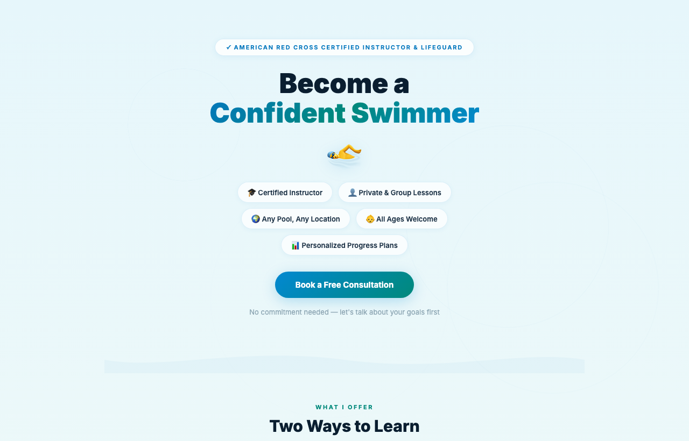

# Swim Lessons

The landing page for my private and group swim lessons. I'm an American Red Cross certified instructor and lifeguard, I teach at the Plano Aquatic Center, and I swam competitively for 8+ years.

**Live site:** [deveshwar123.github.io/Swim](https://deveshwar123.github.io/Swim/)

## What's on the page

- Private and group lesson options, each with a personalized progress plan
- Experience and certifications, with a link to verify the Red Cross certificate
- A three-step "how it works" booking flow
- A contact form that opens a pre-filled email, so the page needs no backend

## Built with

A single static `index.html` with hand-written HTML, CSS and a little vanilla JavaScript, hosted on GitHub Pages. No frameworks and no build step.
